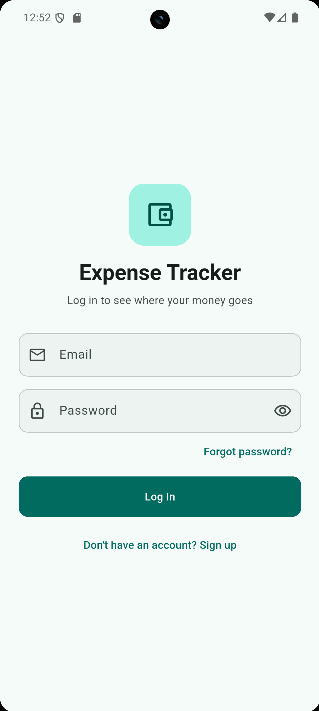
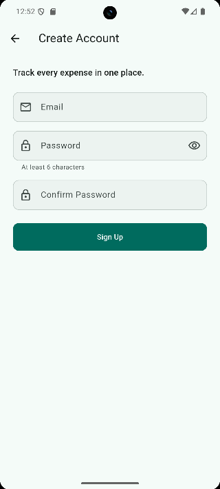
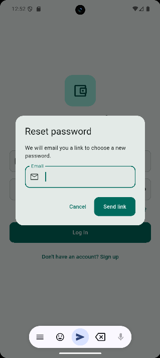
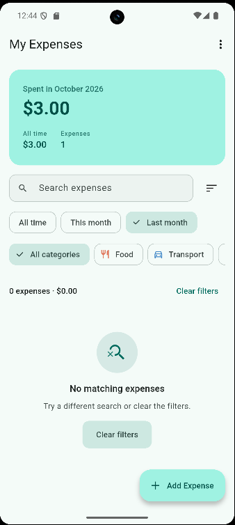
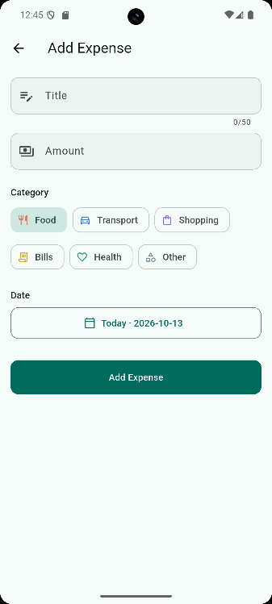
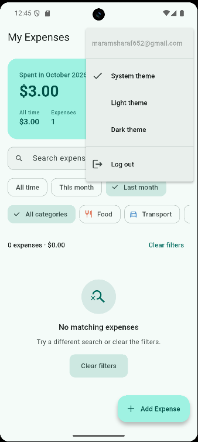
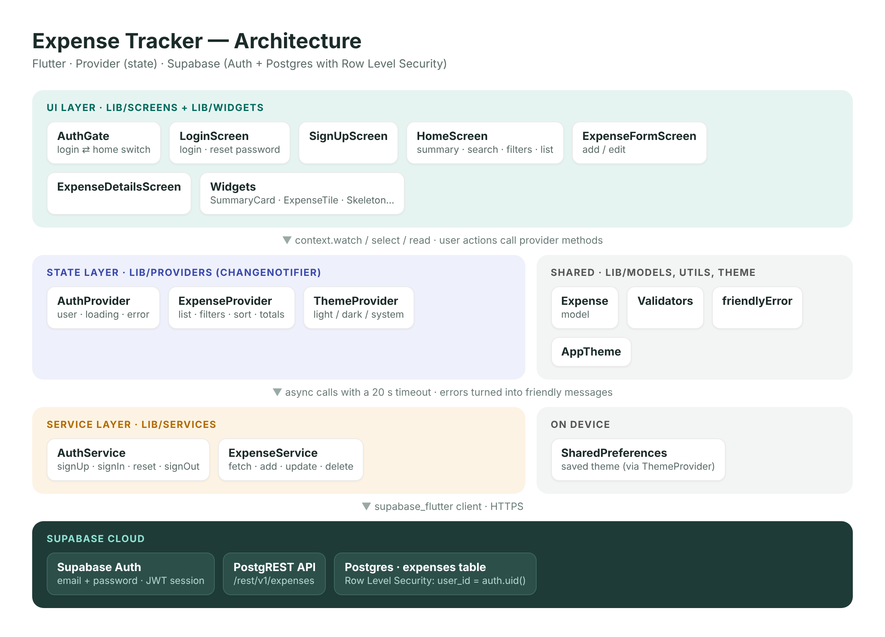
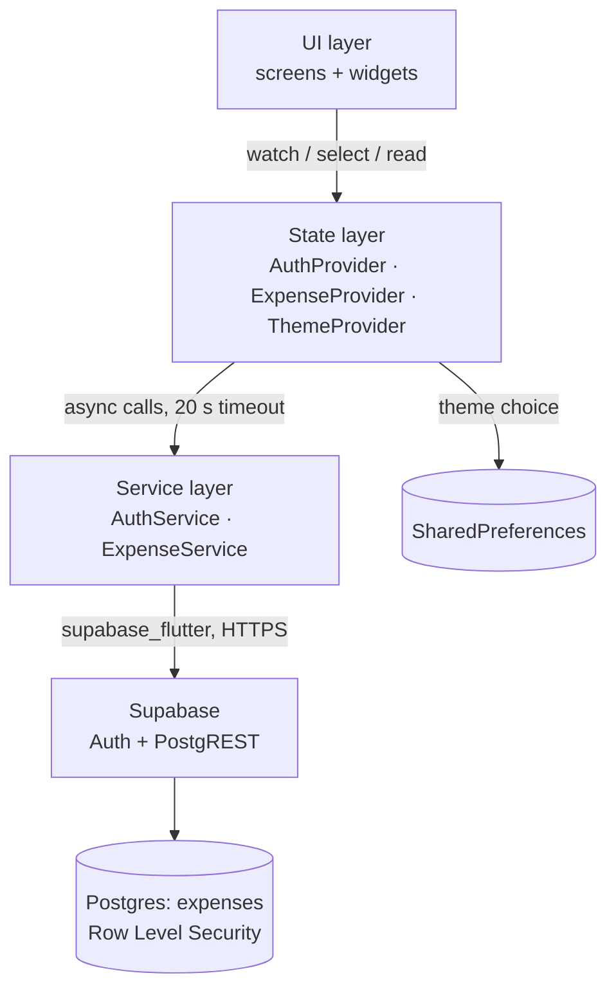
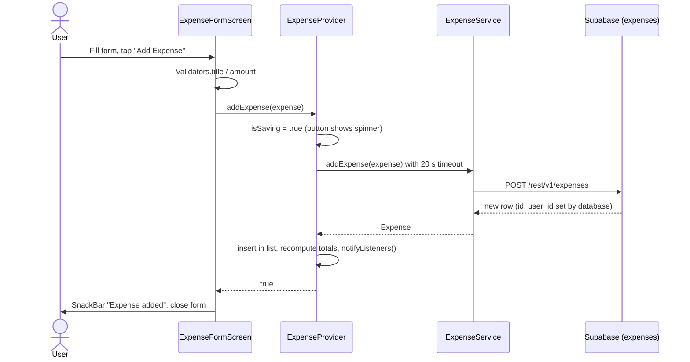

# Expense Tracker

A personal expense tracker built with **Flutter** and **Supabase**.
Each user signs up, logs in and manages their own expenses. Data is stored in
Supabase Postgres and protected with Row Level Security, so nobody can see
another user's expenses.


---

## Table of Contents

1. [Screenshots](#screenshots)
2. [Features](#features)
3. [Tech Stack](#tech-stack)
4. [Architecture](#architecture)
5. [Project Structure](#project-structure)
6. [Setup Instructions](#setup-instructions)
7. [Running Tests](#running-tests)
8. [Building a Release](#building-a-release)
9. [API Documentation](#api-documentation)
10. [Security Notes](#security-notes)
11. [Troubleshooting](#troubleshooting)
12. [Project History](#project-history)

---

## Screenshots

| Login | Create Account | Reset Password |
|:---:|:---:|:---:|
|  |  |  |

| Home | Add Expense | Menu (theme & logout) |
|:---:|:---:|:---:|
|  |  |  |

> Optional extra screens (save them in `docs/screenshots/`):
> `07-expense-list.png` (with several expenses), `08-details.png`, `09-dark-mode.png`.

---

## Features

### Accounts
- Sign up and log in with email and password (Supabase Auth)
- **Forgot password**: sends a reset link by email
- Works with Supabase "Confirm email" on or off, and detects duplicate sign-ups
- Session is remembered; the user stays logged in between launches
- Logging out closes all screens and clears the previous user's data

### Expenses
- **Add, view, edit and delete** expenses (title, amount, category, date)
- 6 categories, each with its own icon and color: Food, Transport, Shopping, Bills, Health, Other
- **Swipe left to delete** with an **Undo** button
- Delete confirmation on the details screen
- "Unsaved changes" warning when leaving the form; editing with no changes does not call the server

### Finding expenses
- **Search** by title or category
- **Filter** by period (All time / This month / Last month) and by category
- **Sort** by newest, oldest, highest or lowest amount
- Results header shows the count and total of the filtered list

### Summary
- Card showing **spent this month**, all-time total and number of expenses
- **Category breakdown bar** with percentages for the expenses shown
- Animated total that counts up to the new value

### Quality
- **Validation**: amount must be a positive number up to 1,000,000 with max 2 decimals
  (rejects `NaN`, `Infinity`, `1e5`, negatives; accepts `12,50` and `1,250.00`);
  title max 50 characters; valid email; password 6–72 characters
- **Error handling**: friendly messages for no internet, timeouts (20 s), wrong
  password, rate limits and permission errors; a failed refresh keeps the list;
  a failed delete puts the item back in place
- **Loading states**: skeleton list, loading buttons, pull to refresh, disabled fields while saving
- **Dark mode**: Light / Dark / System, saved between launches
- **Responsive**: content is centered with a max width on tablets and large screens
- **Accessibility**: respects the system "Reduce motion" setting, semantic labels on icons

---

## Tech Stack

| Area | Technology |
|---|---|
| Framework | Flutter (Material 3), Dart 3.13+ |
| State management | [`provider`](https://pub.dev/packages/provider) `^6.1.5+1` (ChangeNotifier) |
| Backend | [Supabase](https://supabase.com): Auth + Postgres + auto-generated REST API, via [`supabase_flutter`](https://pub.dev/packages/supabase_flutter) `^2.18.2` |
| Local storage | [`shared_preferences`](https://pub.dev/packages/shared_preferences) `^2.5.3` (theme choice) |
| Linting | [`flutter_lints`](https://pub.dev/packages/flutter_lints) `^6.0.0` |
| Testing | `flutter_test` (unit + widget tests) |

---

## Architecture



The app uses a simple **layered architecture**. Each layer only talks to the
layer directly below it:



| Layer | Folder | Responsibility |
|---|---|---|
| **UI** | `lib/screens`, `lib/widgets` | Draws the screens and forwards user actions to providers. Contains no network code. |
| **State** | `lib/providers` | Holds app state (`ChangeNotifier`), runs actions, adds timeouts, turns errors into friendly messages, computes filtered lists and totals once per change. |
| **Service** | `lib/services` | Thin wrappers around the Supabase client: one method per API call. |
| **Shared** | `lib/models`, `lib/utils`, `lib/theme` | `Expense` model, validators, formatters, error messages, category styles, theme. |

### Main data flow: adding an expense



### Authentication flow
`AuthGate` listens to `AuthProvider.isLoggedIn`. It shows `LoginScreen` when
logged out and `HomeScreen` when logged in. `AuthProvider` subscribes to
Supabase's `onAuthStateChange`, so an expired session also returns the user
to the login screen automatically.

---

## Project Structure

```
expense_tracker/
├── lib/
│   ├── main.dart                     # Entry point: Supabase init, providers, themes
│   ├── config/
│   │   └── supabase_config.dart      # Supabase URL + publishable key
│   ├── models/
│   │   └── expense.dart              # Expense model, categories, fromMap / toMap
│   ├── services/                     # API layer (Supabase)
│   │   ├── auth_service.dart
│   │   └── expense_service.dart
│   ├── providers/                    # State management (Provider)
│   │   ├── auth_provider.dart
│   │   ├── expense_provider.dart
│   │   └── theme_provider.dart
│   ├── screens/
│   │   ├── auth_gate.dart            # Login ⇄ Home switch
│   │   ├── login_screen.dart         # Login + reset password dialog
│   │   ├── signup_screen.dart
│   │   ├── home_screen.dart          # Summary, search, filters, list
│   │   ├── expense_form_screen.dart  # Add + edit
│   │   ├── expense_details_screen.dart
│   │   └── expense_actions.dart      # Delete with Undo, delete confirmation
│   ├── theme/
│   │   └── app_theme.dart            # Colors, spacing scale, component styles
│   ├── utils/
│   │   ├── validators.dart
│   │   ├── formatters.dart           # Dates and money
│   │   ├── error_messages.dart       # friendlyError()
│   │   └── category_style.dart       # Icon + color per category
│   └── widgets/                      # Reusable UI pieces
│       ├── summary_card.dart
│       ├── expense_tile.dart
│       ├── expense_list_skeleton.dart
│       ├── loading_button.dart
│       ├── empty_state.dart
│       ├── category_avatar.dart
│       ├── animated_amount.dart
│       ├── fade_slide_in.dart
│       └── responsive_center.dart
├── test/                             # Unit + widget tests
├── supabase/
│   └── schema.sql                    # Table + Row Level Security policies
├── docs/
│   ├── architecture.png
│   ├── API.md                        # API documentation
│   ├── RELEASE.md                    # Build, signing and release testing
│   ├── PRESENTATION.md               # Demo script, speaking parts, video plan
│   └── screenshots/
├── scripts/
│   ├── build_release.ps1             # Windows release build
│   └── build_release.sh              # macOS / Linux release build
├── android/  ios/
├── analysis_options.yaml
└── pubspec.yaml
```

---

## Setup Instructions

### 1. Prerequisites

| Tool | Version |
|---|---|
| Flutter SDK | 3.44 or newer (`flutter --version`) |
| Dart SDK | 3.13 or newer (comes with Flutter) |
| Android Studio | Latest, with Android SDK and an emulator, or a real Android phone |
| JDK | 17 (bundled with Android Studio) |
| Xcode | Only for iOS, on a Mac |
| Supabase account | Free tier is enough: <https://supabase.com> |

Check that everything is installed:

```bash
flutter doctor
```

### 2. Get the code

```bash
git clone <your-repo-url> expense_tracker
cd expense_tracker
flutter pub get
```

### 3. Set up Supabase

1. Create a new project at <https://supabase.com/dashboard>.
2. Open **SQL Editor → New query**, paste the contents of `supabase/schema.sql` and click **Run**.
   This creates the `expenses` table and its Row Level Security policies.
3. Open **Authentication → Providers** and make sure **Email** is enabled.
   - "Confirm email" **on**: new users must click the link in their email before logging in.
   - "Confirm email" **off**: new users are logged in right after signing up (easier for demos).
4. Open **Project Settings → API** and copy the **Project URL** and the **publishable / anon key**.

### 4. Connect the app to your project

Edit `lib/config/supabase_config.dart`:

```dart
class SupabaseConfig {
  static const String url = 'https://YOUR-PROJECT.supabase.co';
  static const String anonKey = 'YOUR-PUBLISHABLE-KEY';
}
```

### 5. Run the app

```bash
flutter devices        # list emulators / phones
flutter run            # debug mode with hot reload
```

---

## Running Tests

```bash
flutter analyze        # static analysis, should report "No issues found!"
dart format --output=none --set-exit-if-changed lib test   # formatting check
flutter test           # unit + widget tests
```

---

## Building a Release

Short version (Android):

```bash
flutter clean
flutter pub get
flutter build apk --release        # build/app/outputs/flutter-apk/app-release.apk
flutter build appbundle --release  # build/app/outputs/bundle/release/app-release.aab
```

Or run the helper script, which also runs analyze and tests first:

```powershell
# Windows
powershell -ExecutionPolicy Bypass -File scripts\build_release.ps1
```
```bash
# macOS / Linux
bash scripts/build_release.sh
```

Full guide: creating a signing key, installing the APK on a phone, the release
test checklist and iOS steps → **[docs/RELEASE.md](docs/RELEASE.md)**.

---

## API Documentation

The app has no custom backend. It uses Supabase's Auth API and the REST API
that Supabase generates for the `expenses` table.

| Action | Dart method | HTTP |
|---|---|---|
| Sign up | `AuthService.signUp` | `POST /auth/v1/signup` |
| Log in | `AuthService.signIn` | `POST /auth/v1/token?grant_type=password` |
| Reset password | `AuthService.sendPasswordReset` | `POST /auth/v1/recover` |
| Log out | `AuthService.signOut` | `POST /auth/v1/logout` |
| List expenses | `ExpenseService.fetchExpenses` | `GET /rest/v1/expenses` |
| Add expense | `ExpenseService.addExpense` | `POST /rest/v1/expenses` |
| Edit expense | `ExpenseService.updateExpense` | `PATCH /rest/v1/expenses?id=eq.{id}` |
| Delete expense | `ExpenseService.deleteExpense` | `DELETE /rest/v1/expenses?id=eq.{id}` |

Request and response examples, the database schema, error codes and the
provider (state) API are in **[docs/API.md](docs/API.md)**.

---

## Security Notes

- The **publishable (anon) key** in `supabase_config.dart` is meant to be
  shipped inside apps. Data is protected by **Row Level Security**: every
  policy checks `auth.uid() = user_id`, so a user can only read or change
  their own rows, even if they call the API directly.
- The `service_role` / secret key is **never** used in the app.
- The release signing key (`*.jks`) and `android/key.properties` are
  git-ignored and must never be shared.
- `user_id` is filled in by the database (`default auth.uid()`), not sent by the app.

---

## Troubleshooting

| Problem | Fix |
|---|---|
| "Could not start Expense Tracker" on launch | Wrong URL or key in `supabase_config.dart`. |
| "No internet connection" in the **release** APK only | `android/app/src/main/AndroidManifest.xml` must contain `<uses-permission android:name="android.permission.INTERNET"/>` (already added in v1.2.0). |
| "Please confirm your email before logging in" | Click the link in the confirmation email, or turn off "Confirm email" in Supabase. |
| "You do not have permission to change this expense" | Row Level Security policies are missing. Run `supabase/schema.sql` again. |
| `flutter.sdk not set in local.properties` | Open the project once in Android Studio or run `flutter pub get`; it recreates `android/local.properties`. |
| Gradle / Kotlin daemon errors | `flutter clean`, then `cd android && ./gradlew --stop`, then build again. |

---

## Project History

| Version | Milestone |
|---|---|
| 1.0.0 | Core CRUD with Supabase, login and sign up |
| 1.1.0 | Day 28 – feature completion: search, filters, sort, summary, undo, dark mode, tests ([report](DAY_28_REPORT.md)) |
| 1.2.0 | Documentation & deployment: README, API docs, architecture diagram, release signing setup, INTERNET permission fix for release builds, presentation materials |

---

**Author:** Maram Sharaf · Built during the Flutter internship program.
